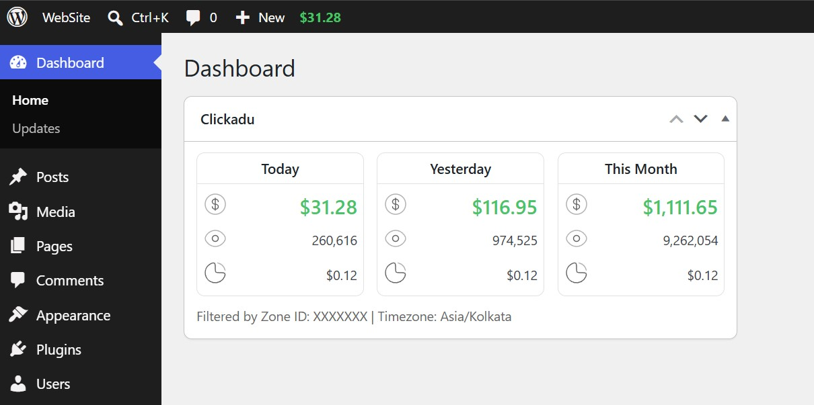

# ClickAdu

A simple WordPress plugin that connects to ClickAdu.com's API to display your earnings, impressions, and CPM directly on your WordPress admin dashboard and top toolbar.



---

## Features

- **Dashboard Widget**: Shows Today's, Yesterday's, and This Month's performance (Earnings, Impressions, and CPM) side by side.
- **Top Toolbar Badge**: Live earnings badge in the WordPress admin bar for quick monitoring from any admin page or front-end view.
- **Zone Filtering**: View data for a specific ad zone using its Zone ID, or leave blank to see total account stats across all zones.
- **Custom Timezone**: Match your ClickAdu reporting timezone (e.g. EST, UTC, Asia/Kolkata).
- **Fast and Cached**: Results are cached server-side using WordPress transients (5-minute cache) to prevent API rate limits and keep your dashboard fast.
- **Secure**: All requests are performed server-side over HTTPS. Only users with administrator capabilities (`manage_options`) can view stats and settings.

---

## Screenshots

### WordPress Dashboard Widget & Admin Bar


### API Settings Page


---

## Requirements

- WordPress 5.6 or higher
- PHP 7.4 or higher
- Active ClickAdu Publisher account

---

## Installation

### Method 1: Upload via WordPress Admin
1. Download this repository as a `.zip` file.
2. In your WordPress admin area, go to **Plugins > Add New > Upload Plugin**.
3. Select the `.zip` file and click **Install Now**.
4. Click **Activate Plugin**. You will be redirected directly to the ClickAdu settings page.

### Method 2: Manual Installation via FTP / SSH
1. Clone or upload the `clickadu` folder into your WordPress plugins directory:
   ```
   wp-content/plugins/clickadu/
   ```
2. In your WordPress admin area, go to **Plugins > Installed Plugins**.
3. Find **ClickAdu** in the list and click **Activate**.

---

## Configuration and Usage Guide

Once activated, follow these steps to connect your ClickAdu account:

1. **Open Settings**:
   Go to **Settings > ClickAdu** in your WordPress admin menu.

2. **Enter your API Token**:
   - Log into your ClickAdu publisher dashboard.
   - Go to [ClickAdu API Integration](https://pub.clickadu.com/apiIntegration).
   - Generate or copy your API Token and paste it into the **API Token** field.

3. **Set API Timezone**:
   - Enter your account reporting timezone (for example: `EST` or `Asia/Kolkata`).
   - Default is `EST`. Check the [ClickAdu Timezones Guide](https://faq.clickadu.com/en/articles/6234945-available-api-timezones) if you are unsure.

4. **Set Zone ID (Optional)**:
   - Enter the Zone ID of the specific ad you want to monitor.
   - If you leave this field blank, the plugin will display aggregate totals for all your zones.

5. **Choose Toolbar Badge Color**:
   - Select either **Green** or **Yellow** for the earnings badge displayed on the top WordPress toolbar.

6. **Save Settings**:
   - Click the blue **Save Settings** button.

7. **View Your Stats**:
   - Go to **Dashboard > Home** to see the **ClickAdu** statistics widget.
   - Look at the top admin bar to check Today's earnings at a glance.

---

## Frequently Asked Questions

**Why does the toolbar or dashboard show an error?**
Make sure your API Token is correct and that your server can make outbound HTTPS requests. Failed requests are temporarily cached for 2 minutes before retrying.

**Why are my daily numbers slightly different from ClickAdu dashboard?**
Ensure that the timezone entered in **Settings > ClickAdu** matches the timezone configured in your ClickAdu publisher account.

**Who can see these statistics?**
Only users with administrator privileges (`manage_options` capability) can view the settings page, the dashboard widget, and the admin toolbar badge.

---

## License

This plugin is open-source software licensed under the [GNU General Public License v2.0 or later](LICENSE).
